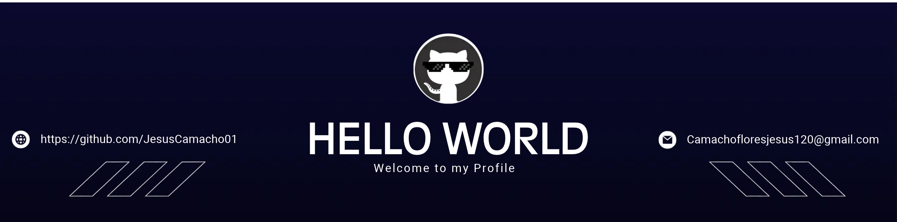

<!--Banner-->

<!--Imagen del búho-->

  

<!--Encabezado de presentación-->
#  Hola, mi nombre es Jesús Camacho! 
*Estudiante de T.S.U. en informática (Developer / Programmer)*
  

<!--Inicio de introducción-->               

Desarrollador Web y (Frontend/UI), estudiante de Informática apasionado por crear soluciones tecnológicas intuitivas que faciliten el día a día del usuario y optimicen sus procesos. Aprendo cada día a usar la Inteligencia Artificial como una excelente aliada para potenciar mi flujo de trabajo 

- Estudiante de la vida :)
- Actualmente estoy aprendiendo muchas cosas; creo que cada día es una oportunidad para aprender.
- Convierto procesos manuales en soluciones claras y automatizadas.
- Integro la Inteligencia Artificial cada día como aliada para optimizar el desarrollo, proponer ideas innovadoras y aplicables al día a día.
- Documento cada proyecto para que cualquier persona del equipo pueda entenderlo y continuarlo.
- 💻 
<!--Fin de introducción-->

<!--Frase-->

  

 

---

<!--Sección de lenguajes y herramientas-->       
     
<h2 align="center">Stack y herramientas</h2> 

### Frontend & UI

  &nbsp;&nbsp;&nbsp;&nbsp;&nbsp;&nbsp;
  &nbsp;&nbsp;&nbsp;&nbsp;&nbsp;&nbsp;
  &nbsp;&nbsp;&nbsp;&nbsp;&nbsp;&nbsp;
  

### Backend

  &nbsp;&nbsp;&nbsp;&nbsp;&nbsp;&nbsp;
  

### Control de versiones y documentación

  &nbsp;&nbsp;&nbsp;&nbsp;&nbsp;&nbsp;
  &nbsp;&nbsp;&nbsp;&nbsp;&nbsp;&nbsp;
  

 

## Proyectos colaborativos

### Sistema Naguara

| | |
|---|---|
| **Problema que resuelve** | Digitaliza y optimiza la gestión administrativa, el control de inventario y el punto de venta (POS) de una pollera local. |
| **Mi aporte** | Desarrollo de la arquitectura inicial del proyecto, estructura modular y diseño/maquetación de la mayoría de las vistas de usuario (Frontend/UI). |
| **Tecnologías** | HTML · CSS · Tailwind CSS · JavaScript · Node.js · PostgreSQL |
| **Repositorio** | [Ver repositorio](https://github.com/JesusCamacho01/Naguara_Proyect) |

 

### H2O Manager

| | |
|---|---|
| **Problema que resuelve** | Centraliza las operaciones de recarga y distribución de agua potable, controlando inventario de botellones retornables, ventas, tasa cambiaria y contabilidad. |
| **Mi aporte** | Prototipado completo UI/UX en Figma y estructuración funcional de las pantallas operativas y del módulo contable. |
| **Tecnologías** | Figma · React · Tailwind CSS · Laravel · MySQL / PostgreSQL |
| **Repositorios y Docs** | [Frontend](https://github.com/JesusCamacho01/H2Omanager) · [Backend](https://github.com/JesusCamacho01/api-h2o-manager) · [Prototipo Figma](https://www.figma.com/design/nlTWprmKeubz5lJlKaxo01/Prototipo-H2OManager?node-id=0-1&p=f&t=m62IrE82o4X7CjjO-0) · [Documentación](https://docs.google.com/document/d/1leRalyjhO8xi093IYxyOnxWyIvK1M08yp_zIUkPWuyc/edit?tab=t.0) · [Diagrama BD](https://dbdiagram.io/d/Proyecto-Contable-6993c4edbd82f5fce2e2d134) |

---

## Contacto

  &nbsp;&nbsp;&nbsp;&nbsp;
  &nbsp;&nbsp;&nbsp;&nbsp;
  &nbsp;&nbsp;&nbsp;&nbsp;
  

    

  
    <strong>Correos:</strong>
    <a href="mailto:Camachofloresjesus120@gmail.com">Camachofloresjesus120@gmail.com</a> ·
    <a href="mailto:Vjal.camachofloresjesus120@iujo.edu.ve">Vjal.camachofloresjesus120@iujo.edu.ve</a>
  

   
  Gracias por visitar mi perfil.

